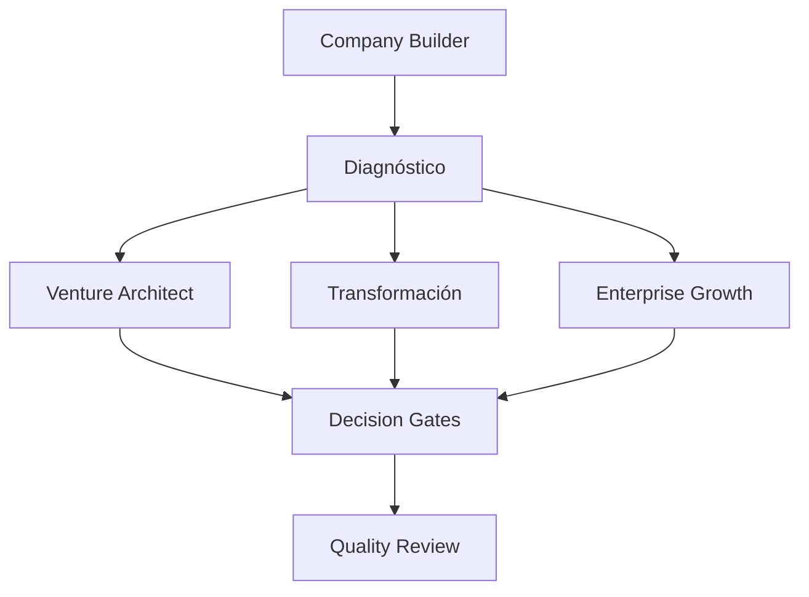

# Dependencias y grafo de capacidades

Resolver skills por `name`; flechas representan outputs previos candidatos, no obligación de ejecutar toda la lista. Aceptar evidencia equivalente ya existente. Sin cycles; validar con scripts/validate_library.py.

| Capacidad coordinadora | Inputs desde capacidades candidatas |
|---|---|
| business-diagnostic | process-mapping, financial-diagnostic, customer-research, business-model-analysis |
| business-health-assessment | financial-diagnostic, operational-kpis, retention |
| go-to-market | problem-validation, value-proposition-design, unit-economics, marketing-strategy, sales-discovery, launch-readiness |
| brand-development | brand-research, brand-strategy, brand-voice, visual-identity, brand-quality-assurance |
| premium-digital-experience-builder | web-strategy, ux-research, ui-direction, secure-development, web-performance, web-quality-assurance |
| revenue-intelligence | conversion-analysis, sales-discovery, lead-qualification, margin-analysis, retention, marketing-analytics |
| aem-venture-architect | opportunity-discovery, problem-validation, customer-discovery, market-validation, business-model-design, unit-economics, mvp-strategy, go-to-market, business-decision-gates |
| aem-company-builder | business-diagnostic, aem-venture-architect, aem-business-transformation, enterprise-growth-orchestrator, business-decision-gates |
| aem-business-transformation | business-diagnostic, process-optimization, financial-diagnostic, business-strategy, automation-design, business-decision-gates |
| enterprise-growth-orchestrator | growth-strategy, revenue-intelligence, scaling-readiness, operational-scalability, organizational-scalability, business-decision-gates |
| quality-council | business-decision-gates |
| aem-skill-factory | aem-skill-system |

No hay dependencia inversa de atómicas a orquestadores. El quality loop es wrapper de ejecución, no dependency recursiva. Policy y schemas están dentro de cada paquete para que pueda trasladarse solo.
